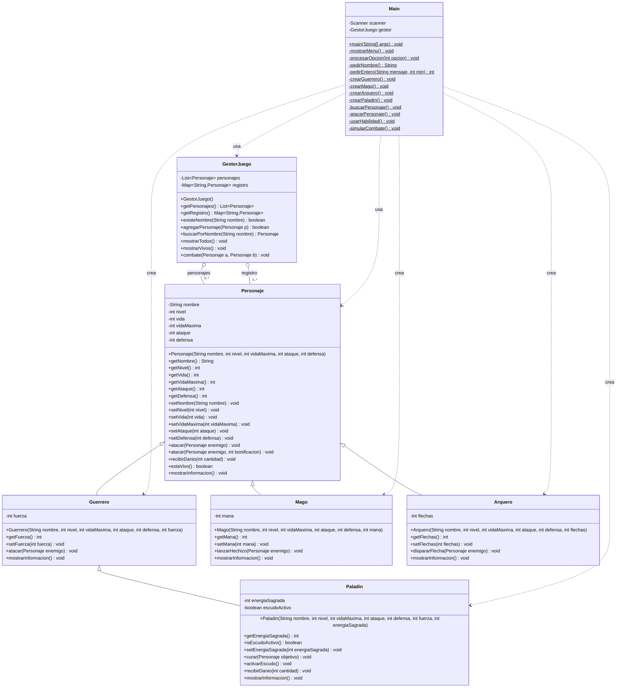

# Escuela Politécnica Nacional EPN  
## Escuela de Formación de tecnólogos ESFOT  
### 🎮 ESFOT RPG: La Batalla de los Reinos

> Estudiante: Melva Patricia Suarez C.   
> Asignatura: Programación Orientada a Objetos  
> Lenguaje: Java (JDK 21+)  
> Modalidad: Individual

### 📖 Descripción del proyecto

**ESFOT RPG:** La Batalla de los Reinos es un prototipo de juego de rol (RPG) por consola desarrollado en Java puro, sin interfaz gráfica ni base de datos.

El objetivo es poner en práctica los pilares de la Programación Orientada a Objetos mediante un caso real: registrar héroes de distintos tipos, consultarlos, ejecutar habilidades especiales y enfrentarlos en combates por turnos.

**El sistema permite:**

1. rear personajes de cuatro clases: Guerrero, Mago, Arquero y Paladín.
2. Consultar todos los personajes registrados mediante polimorfismo.
3. Buscar personajes por nombre usando un HashMap.
4. Ejecutar ataques normales, ataques con bonificación y habilidades especiales.
5. Simular un combate por turnos entre dos personajes.
6. Validar entradas del usuario y estados internos de los objetos.

> Este proyecto fue desarrollado como tarea integradora y demuestra la implementación de:

- Herencia simple, jerárquica y multinivel.
- Encapsulamiento con setters validados.
- Constructores con llamada a super(...).
- Sobrescritura (@Override) y sobrecarga.
- Polimorfismo mediante referencias Personaje.
- instanceof y casting seguro para habilidades específicas.
- Colecciones: ArrayList y HashMap.
- Menú interactivo con Scanner y manejo de errores.

### ⚙️ Requisitos previos

Para ejecutar el proyecto es necesario contar con:

- Java JDK 21 o superior.
- Terminal o consola de comandos.
- (Opcional) IDE como IntelliJ IDEA, Eclipse o VS Code con extensión de Java.

**Para verificar la versión de Java instalada, ejecuta:**
```azure
    java -version
```

### 🚀 Instrucciones de ejecución
**1. Clonar el repositorio**

```azure
    git clone https://github.com/MelvaSuarez29/videojuego-Batalla-Reinos.git  
    cd esfot-rpg-batalla-reinos
```
**2. Compilar el proyecto** 

Desde la raíz del proyecto, ejecuta:

bash
javac -d out src/personajes/*.java src/juego/*.java src/Main.java

**3. Ejecutar el juego**  
    ```
    java -cp out Main 
    ```

**4. (Opcional) Ejecutar desde un IDE**

En la carpeta del proyecto desde:  
    src/ como carpeta de fuentes y ejecutar la clase Main.

### 🗂️ Estructura del proyecto

La organización de archivos y paquetes del proyecto es la siguiente:
```
videojuego_RP/
├── src/
    ├──juego/
│   │   └── GestorJuego.java
│   ├── personajes/
│   │   ├── Personaje.java
│   │   ├── Guerrero.java
│   │   ├── Mago.java
│   │   ├── Arquero.java
│   │   └── Paladin.java
│   └── Main.java
├── Diagrama_UML/
│   ├── diagrama_clases.png.
│   └── diagrama_clases.drawio
├── README.md
└── .gitignore
```
## Diagrama UML

>Imagen:  
> Diagrama:

### 🛠️ Tecnologías y buenas prácticas utilizadas
- Java 17 (compatible con versiones superiores).
- Programación orientada a objetos sin frameworks.
- Separación por paquetes: personajes, juego, Main.
- Validaciones centralizadas en setters.
- Mensajes de error claros al usuario.
- .gitignore configurado para excluir *.class, out/, archivos de IDE.

---
*Autora: Melva Suarez*
> El siguiente proyecto se lo realizó con fines académicos, como repaso de la materia Porgramación Orientada a Objetos
> siguiendo las directrices del siguiente repositorio: https://github.com/jzaldumbide/actividad_de_repaso_POO.git
