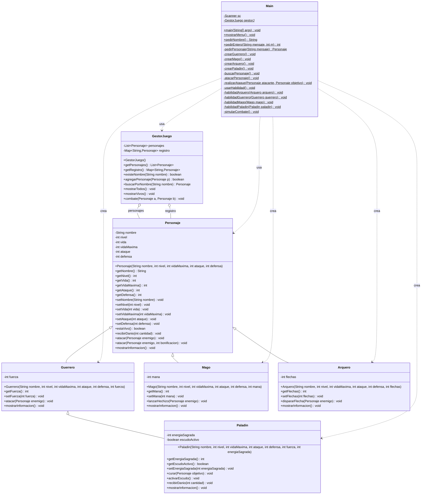

# Escuela Politécnica Nacional EPN
## Escuela de Formación de Tecnólogos ESFOT
### 🎮 ESFOT RPG: La Batalla de los Reinos

> Estudiante: Melva Patricia Suarez C.
> Asignatura: Programación Orientada a Objetos
> Lenguaje: Java (JDK 21 o superior)
> Modalidad: Individual

## 📖 Descripción del proyecto

**ESFOT RPG: La Batalla de los Reinos** es un prototipo de juego de rol (RPG) por consola desarrollado en Java puro, sin interfaz gráfica ni base de datos. El objetivo es aplicar los pilares de la Programación Orientada a Objetos en un caso real: registrar héroes de distintos tipos, consultarlos, ejecutar habilidades especiales y enfrentarlos en combates por turnos.

**El sistema permite:**

1. Crear personajes de cuatro clases: Guerrero, Mago, Arquero y Paladín.
2. Consultar todos los personajes registrados mediante polimorfismo.
3. Buscar personajes por nombre usando un `HashMap`.
4. Ejecutar ataques normales, ataques con bonificación y habilidades especiales.
5. Simular un combate por turnos entre dos personajes.
6. Validar las entradas del usuario y los estados internos de los objetos.

El proyecto demuestra la implementación de:

- Herencia **simple**, **jerárquica** y **multinivel**.
- **Encapsulamiento** con atributos privados y setters validados.
- **Constructores** con llamada a `super(...)`.
- **Sobrescritura** (`@Override`) y **sobrecarga**.
- **Polimorfismo** mediante referencias de tipo `Personaje`.
- **`instanceof` y casting seguro** para habilidades específicas.
- Colecciones: `ArrayList` y `HashMap`.
- **Menú interactivo** con `Scanner` y validación de entradas.

> Alcance respetado: no se utilizan interfaces, clases abstractas ni patrones de diseño.

## ⚙️ Requisitos previos

Para ejecutar el proyecto es necesario contar con:

- Java JDK 21 o superior.
- Terminal o consola de comandos.
- (Opcional) IDE como IntelliJ IDEA, Eclipse o VS Code con extensión de Java.

Para verificar la versión de Java instalada, ejecuta:

```
java -version
```

## 🗂️ Estructura del proyecto

```
videojuego-Batalla-Reinos/
├── src/
│   ├── Main.java
│   ├── juego/
│   │   └── GestorJuego.java
│   └── personajes/
│       ├── Personaje.java
│       ├── Guerrero.java
│       ├── Mago.java
│       ├── Arquero.java
│       └── Paladin.java
├── Diagrams/
│   └── diagrama_clases.png
├── Screenshots/
│   ├── creacion.jpg
│   ├── busqueda.jpg
│   ├── habilidad.jpg
│   └── combate.jpg
├── README.md
└── .gitignore
```

La organización por paquetes (`personajes`, `juego` y `Main`) es equivalente a la estructura sugerida: `Main` controla la consola y `GestorJuego` administra las colecciones y los combates.

### Responsabilidad de cada clase

| Clase | Rol |
|---|---|
| `Personaje` | Clase base concreta con atributos comunes, validaciones y sobrecarga de `atacar`. |
| `Guerrero` | Subclase que añade `fuerza` y sobrescribe `atacar`. |
| `Mago` | Subclase que añade `mana` y `lanzarHechizo`. |
| `Arquero` | Subclase que añade `flechas` y `dispararFlecha`. |
| `Paladin` | Subclase de `Guerrero` (herencia multinivel) con curación y escudo. |
| `GestorJuego` | Administra `ArrayList` + `HashMap` y la lógica de combate. |
| `Main` | Controla la interacción por consola (menú, entrada y salida). |

## 💻 Instrucciones de ejecución

### 1. Clonar el repositorio

```
git clone https://github.com/MelvaSuarez29/videojuego-Batalla-Reinos.git
```

```
cd videojuego-Batalla-Reinos
```

### 2. Compilar el proyecto

Desde la raíz del proyecto:

```
javac -d out src/personajes/*.java src/juego/*.java src/Main.java
```

### 3. Ejecutar el juego

```
java -cp out Main
```

### 4. Ejecutar desde un IDE

Abrir la carpeta del proyecto, marcar `src/` como carpeta de fuentes (*Sources Root*) y ejecutar la clase `Main`.

##  Diagrama UML

> **Imagen:** [Diagrama de clases](diagrams/diagrama_clases.png)



## 📸 Capturas de pantalla

Las evidencias de ejecución se almacenan en la carpeta `Capturas`:

| Archivo | Evidencia |
|---|---|
| [creacion.jpg](screenshots/creacion.jpg) | Creación de un personaje de cada tipo y visualización de atributos con polimorfismo. |
| [busqueda.jpg](screenshots/busqueda.jpg) | Búsqueda por nombre con `HashMap`, nombre inexistente y rechazo de duplicado. |
| [habilidad.jpg](screenshots/habilidad.jpg) | Hechizo con y sin maná, flechas hasta agotarlas, curación y escudo del Paladín. |
| [combate.jpg](screenshots/combate.jpg) | Combate completo por turnos con daño efectivo, vida restante y ganador. |

## 🧪 Pruebas mínimas realizadas

| # | Prueba | Resultado |
|---|---|---|
| 1 | Crear un personaje de cada tipo y mostrar atributos | [x] Correcto: se muestran los datos generales y los atributos propios. |
| 2 | Rechazar nombre duplicado y estadística inválida | [x] Correcto: `containsKey` rechaza duplicados; los setters validan rangos. |
| 3 | Ataque normal y ataque con bonificación | [x] Correcto: se ejecutan ambas sobrecargas de `atacar`. |
| 4 | Daño respeta defensa y la vida no baja de 0 | [x] Correcto: `Math.max(1, cantidad - defensa)` y `Math.max(0, ...)`. |
| 5 | Hechizo con y sin maná suficiente | [x] Correcto: con 10 de maná consume y daña; sin maná no consume. |
| 6 | Disparar flechas hasta agotarlas | [x] Correcto: al llegar a 0 informa y no consume. |
| 7 | Curación tope en `vidaMaxima` y escudo del Paladín | [x] Correcto: la cura no supera el máximo; el escudo absorbe 5 y se desactiva. |
| 8 | Recorrer `List<Personaje>` con polimorfismo | [x] Correcto: se ejecuta la versión sobrescrita de `mostrarInformacion`. |
| 9 | Buscar por nombre con `HashMap` | [x] Correcto: encuentra sin distinguir mayúsculas y valida duplicados. |
| 10 | Combate completo con ganador anunciado | [x] Correcto: alterna turnos, muestra daño y vida, y anuncia al ganador. |

## 🧠 Respuestas a las preguntas de análisis

### 1. ¿Dónde se aplica herencia simple en el proyecto?

### 2. ¿Por qué `Personaje → Guerrero → Paladin` representa herencia multinivel?

### 3. ¿Qué relación ejemplifica herencia jerárquica?

### 4. ¿Cuál es la diferencia entre sobrescritura y sobrecarga de `atacar()`?

### 5. ¿Qué aporta `super` en constructores y métodos?

### 6. ¿Por qué `List<Personaje>` admite guerreros, magos, arqueros y paladines?

### 7. ¿Qué versión de `mostrarInformacion()` se ejecuta al recorrer la lista y por qué?

### 8. ¿Cuándo se necesita `instanceof` antes de hacer casting?

### 9. ¿Qué ventaja aporta `HashMap` para localizar un personaje por nombre?

### 10. ¿Cómo se protege la consistencia de los atributos mediante encapsulamiento?

## 🛠️ Tecnologías utilizadas

- Java 21 o superior (compatible con versiones superiores).
- Programación orientada a objetos sin frameworks.
- Separación por paquetes: `personajes`, `juego` y `Main`.
- Validaciones centralizadas en setters y en los métodos de acción.
- Mensajes claros al usuario para entradas y estados inválidos.
- `.gitignore` configurado para excluir `*.class`, `out/`, `.idea/` y `*.iml`.

---

***Autora:** Melva Suarez*
***Repositorio:** https://github.com/MelvaSuarez29/videojuego-Batalla-Reinos.git*

> Este proyecto se realizó con fines académicos como repaso de la asignatura Programación Orientada a Objetos, siguiendo las directrices del repositorio: https://github.com/jzaldumbide/actividad_de_repaso_POO.git
